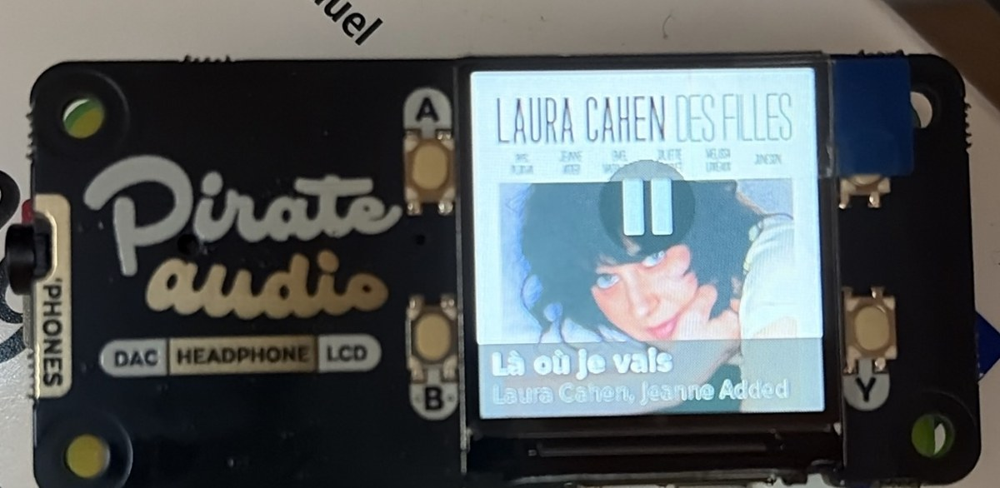

# Pirate Audio × Spotify Connect, with album art

Turn a **Raspberry Pi Zero W** and a **Pimoroni Pirate Audio** HAT into a Spotify Connect speaker. The 240×240 screen shows the album cover with the track and artist, and the four buttons control playback.



- **Spotify Connect** via [go-librespot](https://github.com/devgianlu/go-librespot). It ships an ARMv6 build, while Raspotify no longer supports the Pi Zero W / Pi 1.
- **Album art without a Spotify developer key**: the cover URL comes from go-librespot's local websocket API (`/events`).
- **Buttons**: A = play/pause · B = volume − · X = next (long press = previous) · Y = volume +
- Title/artist banner, pause icon, temporary volume bar, idle screen, and the backlight turns off after 5 minutes of inactivity.

## Tested on

| | |
|---|---|
| Board | Raspberry Pi Zero W (ARMv6) |
| HAT | Pimoroni Pirate Audio (headphone version) |
| OS | Raspberry Pi OS Lite **32-bit, Trixie** |
| go-librespot | v0.10.2 |

It should also work on Bookworm and on newer Pis (the installer picks the arm64 binary on a 64-bit OS), but those setups have not been tested.

## Install

1. Flash Raspberry Pi OS Lite with Raspberry Pi Imager, setting up Wi-Fi, SSH and your user there.
2. On the Pi:

   ```bash
   git clone <this-repo-url> pirate-spotify
   cd pirate-spotify
   ./install.sh        # run as your normal user, NOT with sudo
   sudo reboot
   ```

3. Open the Spotify app on the same network and pick the **Pirate Audio** device. A Spotify Premium account is required.

`install.sh` does the following:

- installs the apt packages;
- enables SPI;
- adds `dtoverlay=hifiberry-dac` and `gpio=25=op,dh` to `config.txt`, disables onboard audio, and backs up the original `config.txt`;
- installs go-librespot to `/usr/local/bin`;
- sets up a Python venv in `/opt/pirate-display`;
- adds your user to the `audio`, `gpio` and `spi` groups;
- enables two systemd services, `go-librespot` and `pirate-display`.

## Files

| File | Purpose |
|---|---|
| `install.sh` | One-shot installer |
| `config.yml` | go-librespot config: device name, bitrate, zeroconf via avahi, local API on `localhost:3678` |
| `pirate_display.py` | Screen and buttons: listens to go-librespot events and calls its REST API |

## Settings

These are environment variables in `/etc/systemd/system/pirate-display.service`. After editing, run `sudo systemctl daemon-reload && sudo systemctl restart pirate-display`.

| Variable | Default | Meaning |
|---|---|---|
| `SLEEP_AFTER` | `300` | Seconds of inactivity before the backlight turns off |
| `VOL_STEP` | `5` | Volume step per button press (out of 100) |
| `PIRATE_Y_PIN` | `24` | Y button pin. Older boards use `20` |

The device name, bitrate (default 160, can be 320) and initial volume are set in `~/.config/go-librespot/config.yml`.

## Troubleshooting

```bash
aplay -l                                    # the hifiberry DAC should be card 0
systemctl status go-librespot pirate-display
journalctl -u go-librespot -u pirate-display -b --no-pager | tail -50
```

- **Screen full of colourful "snow"**: the backlight is on but the script crashed before drawing anything. Check the `pirate-display` logs.
- **`invalid config override format: onfig_dir`**: go-librespot needs `--config_dir` with **two** dashes.

### Why the GPIO code looks unusual

On Raspberry Pi OS Trixie 32-bit on a Pi Zero W, all the usual GPIO libraries failed:

- `gpiod` (`request_lines` → `EINVAL`)
- `lgpio` (`gpio_claim_input` → `unexpected error`)
- gpiozero's sysfs fallback (`export` → `EINVAL`, because GPIO numbering is offset by 512 on recent kernels)

So `pirate_display.py` drives the pins directly through `/dev/gpiomem`, using `gpiozero.pins.native.NativeFactory`:

- the display's DC and backlight pins are passed to the `st7789` library as `(object, offset)` tuples;
- the buttons are read by polling every 20 ms instead of using edge interrupts.

This only works on Pis up to the Pi 4 (BCM283x/2711), not on the Pi 5. If you know why gpiod/lgpio fail on this setup, issues and PRs are welcome.

## Credits

- [go-librespot](https://github.com/devgianlu/go-librespot) by devgianlu
- [Pimoroni Pirate Audio](https://github.com/pimoroni/pirate-audio) and [st7789-python](https://github.com/pimoroni/st7789-python)
- [gpiozero](https://github.com/gpiozero/gpiozero)

Not affiliated with Spotify or Pimoroni.

## License

MIT, see [LICENSE](LICENSE).
